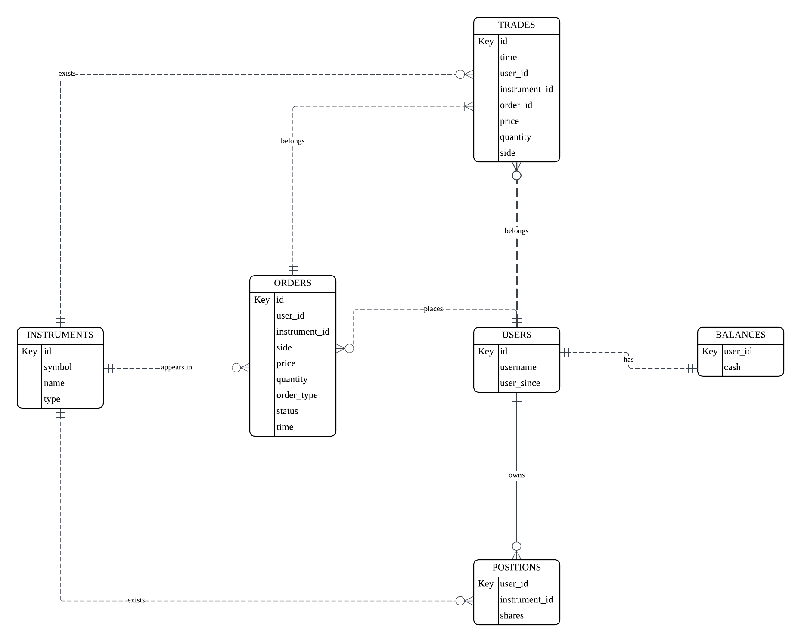

# Design Document

By Sofia

Video overview: (https://youtu.be/DhC73hX7SkQ)

## Purpose

The database for the CS50 SQL Final Project includes all entites necessary for the Shenzhen Stock Exchange and its users to keep track of tick data for all orders and transactions.

## Scope

###### Tables:

- **Trades**, including the basic information for executed transactions, linking back to the Orders table. A trade may correspond to a single order when the order is filled in one execution, or it may correspond to a partial fill portion when the order is partially filled, or multipe trades may correspond to multiple executions of an order which is filled in different shapes.
- **Users**, including basic user information.
- **Balances**, including cash balances for each user.
- **Positions**, including cumulative trade positions for each user per instrument.
- **Instrument**, including all available stocks, ETFs, futures, and options avaialble for trading on the Shenzhen Stock Exchange.
- **Orders**, including all market or limit orders whether filled or open, placed by a specific user on a specific instrument. It records the basic information of each placed order.

**Out of scope** are elements like transaction fees, brokerage, counterparties, etc.

###### Views:

 *Order_Book: This view provides users with a convenient way to view the order book for a particular stock. Through the order book, it displays the best bid and best ask prices, along with their associated bid/ask sizes, as placed via limit orders.

 The design of the order book view strictly follows the price-first, time-second trading rules, as denoted in the CTE temp table which `price desc/asc, time desc`, The order book is separated into two sections: one for bids and one for asks. Each section displays the top 5 best bid/ask levels and their corresponding sizes.

###### Triggers:

1.**Update balance**: Once a row is inserted into the trades table, a trigger will update the cash balance for the user based on the trade notional.
2.**Update positon**: Once a row is inserted into the trades table, a trigger will update the shares inventory for the user based on the trade quantity.

If either the update balance trigger or the update position trigger violates a column check constraint in the balances or positions table, the transaction will be rolled back, meaning no changes will be made, including the insertion into the trades table.

## Functional Requirements

This database will support:

* CRUD operations for Shenzhen Stock Exchange and its user
* Tracking all trades and orders placed on the ShenZhen Stock Exchange for shares, ETFs, futures and options
* Convenient views of the best_bid and best_ask for limit orders on order books
* Auto updates to user balances and positions upon sucessful execution of a trade

## Representation

Entities are captured in MySql tables with the following schema.

### Entities

The database includes the following entities:

#### Trades

The trades table includes:

* id: The unique identifier for each trade execution. Given the volume of exchange tick data, a bigint type is used to uniqurly identify each executed transactions.
* time: Used datatime datatype to represent the timestamp when the trade was successfully executed. Defaults to Current_TimeStamp.
* user_id: The user who placed trade. This column is a foreign key referencing the users table.
* instrument_id: The instrument involved in the trade. An instrument can be traded in multiple trades, so this column has a foreign key constraint referencing the instruments table.
* order_id: The order to which this trade belongs. A single order can produce multiple trades, so this column has a foreign key constraint referencing the orders table.
* price: The unit price of the stock, future, or option. Sinxe the price cannot be negative, it is safe to use an unsigned decimal type with precision (18,2). This allows up to 2 decimal places, with a total of 18 digits, supporting prices up to CNY 9,999,999,999,999,999.99.
* quantity: The number of shares or units in the transaction. Must be an integer, as fractional trading is not allowed in SZSE.
* side: Indicated whether the trades is a Buy or Sell. Short selling and margin buying are not permitted, so this column uses as ENUM type with values 'S' (Sell) and 'B' (Buy).

All columns in the trades table have a not null constraint.

#### Users

The users table includes:

* id: The unique identifier for each registered user. Given the volum of SZSE, a bigint type is used to identify the user.
* username: Each user must create a unique username for their account. A unique constraint is applied, and VARCHAR(50) allows a variable length of characters for the username.
* user_since: Provides additionaly information to understand how long the user has been registered with the exchange.

#### Balances

The balances table includes:

* user_id: The unique identifier for each user's balance. It references the id column in the users table, serving as the primary key that links the balances table to the users table.
* cash: The cash balance available to the user, used to validate whether the user has sufficient funds to make further trades. A check constraint ensures the cash balance is greater than or equal to zero. It defaults to zero when a new balance record is created for a new user.

#### Positions

The positions table includes:

* user_id: Forms part of the composite primary key in conjuction with the instrument_id column.
* instrument_id: Forms part of the composite primary key in conjuction with the user_id column.
* shares: Specifies the cumulative position for each unique combination of user and instrument, representing the current available inventory of stocks.

#### Instruments

* id: The unique identifier for all available instruments listed on the Shenzhen Stock Exchange. This is the primary key for the table.
* symbol: The ticker symbol, which is the short form used to identify the instrument. Uses VARCHAR(20) to store the symbol, allowing a variable-length string of up to 20 characters.
* name: The long or full name of the instrument,typically the full name of the listed company on the exchange. Uses VARCHAR(255) to allow a reasonable length for storing the instrument name.
* type: The instrument type. Since the design has a limited set of options, this column uses an ENUM type to allow only 'stock', 'etf', 'future', or 'option'.

A list of stocks listed in SZSE [stocks available for trading](https://stockanalysis.com/list/shenzhen-stock-exchange/)
A list of ETFs listed in SZSE [ETFs available for trading](https://www.szse.cn/English/siteMarketData/siteMarketDatas/funds/)

#### Orders

* id: The unique identifier of an order. This is the primary key column for the orders table. A bigint type is used given the volume of orders data.
* user_id: Specifies which user the order belongs to. Each order can belong to only one user. A bigint type is in used give the volume of the users. This is a foreign key referening to the id column of the users table.
* instrument_id: Specifies which instrument is being traded in the order. Each order can be placed on only one instrument, thus it is a foreign key referening to id column of the instruments table.
* side: Specifies the direction of the order. It can either be a Buy order, or Sell order, thus a ENUM type with values of 'B' or 'S'.
* price: The unit price of the stock, future, or option. Sinxe the price cannot be negative, it is safe to use an unsigned decimal type with precision (18,2). This allows up to 2 decimal places, with a total of 18 digits, supporting prices up to CNY 9,999,999,999,999,999.99.
* quantity: The number of shares, ETFs, futures, or options in the order. As quantity have to be greater than zero, hence, an unsigned integer type with a check constraint of quantity > 0.
* order_type: Either be a limit order or a market order, thus using an ENUM('limit','market') data type.
* status: Either be an open order or a filled order, thus using ENUM('open','filled') data type.
* time: Uses datatime tpe to represent the current timestamp to capture the precise time at which the order was places, default as current_timestamp.

All columns in the orders table have a not null constraint.

The `order_type` olumn, which contains the ENUM selections of 'limit' and 'market', can be cross-combined with the `status` column. For example, a limit order can be both 'open' and 'filled', and a market order can also be both 'open' (when there isn't enough liquidity, even a market order may not be immediately filled and thus remains open) and 'filled'.

### Relationships

The below entity relationship diagram describes the relationships among the entities in the database.

As detailed by the diagram:

* One order can only involve one instrument; however, one instrument can appear on many orders. Therfore, there is a one-to-many relationship between instruments and orders.
* One order can only belongs to one user; however, one user can place many orders. Therefore, there is a one-to-many relationship between users and orders.
* One trade can only belongs to one order; however, one order can result in one trade or multiple trades. This is because an order is normally filled in multiple steps at different levels of price, size and time. A filled order will go into the trades table with the exact price, size, and time that compose the entire order. Alternatively speaking, an order can be filled in different shapes of trades.
* When an order is successfully placed, if and only if the order is filled (the status column in the orders table shows as 'filled'), then the order will become a trade or multiple trades. Upon a new trade being created, the user's available cash balance will be updated by adding or deducting the trade notional amount, depending on the order direction (whether it is sell or buy).
* When an order sucessfully placed, if and only if the order is filled, the order will become a new trade or multple new trades, which will update the user's stock inventory on the traded instrument in the positions entity.

## Optimizations

Per the typical queries in `queries.sql`, it is common for users of the database to access trades, balances, positions, orders for a specific user based on username. For that reason, an index is created on the username column of users table.

Additionally, it is common for users to view trades and orders for a specific instrument based on its symbol, or to purely check instrument information based on the ticker/symbol. Thus, an index is created on the symbol column of the instruments table.

Furthermore, the order book will filter only `open` and `limit` order observations from the orders table,. Therefore, indexes are created on the `status` and `order_type` columns of the orders table to speed up the filtering process when forming the vitual view table.

Lastly, the order book also uses a window function to partition all filtered observations based on the `instrument_id` and `side` columns from the orders table. This groups the filtered observations by instrument and order direction, and then assigns sequential ordering on the `price` column. Thus, indexes are created on the `instrument_id` and `side` columns of the orders table for quicker partitioning..

## Limitations

The current schema omits transaction fee, counterparties, brokerage information.
Given the difficulty of performing a full outer join in MySql to produce an entire order book view, the view has been separated into two views: `order_book_bid` and `order_book_ask`.
