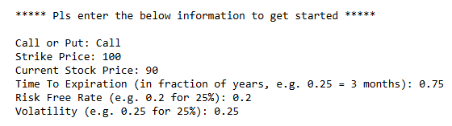
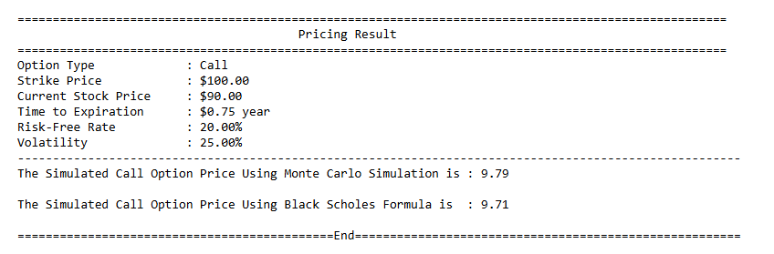
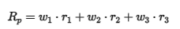
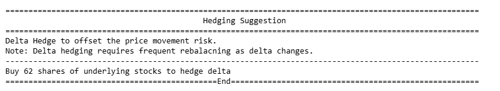

# European Option Pricing with Black Scholes Merton Model and Monte Carlo Simulation

By Sofia

Video Overview: (https://youtu.be/ZQMgIL_UfRk)

## Purpose

**Reference**: the latex for formulas in current README.md is generated with AI. The BSM model assumptions is cited from [Analyst Prep](https://analystprep.com/study-notes/frm/part-1/valuation-and-risk-management/the-black-scholes-merton-model/)

This project is for "CS50X final project", the topic I selected is to build a European Option Pricing Model using two approaches, including **Monte Carlo Simulation** and **Black-Scholes-Merton Model (BSM)**.

Given Black Scholes is a very famous closed form formula which can compute the European Call/Put Option by simply subsituting the inputs, then it will produce the outputs, which is the option price, or option premium.

In comparison, the Monte Carlo Simulation is using numerical simualtion to approx the option price, it is supposed to closely match the analytic result from the BSM model.

Hence, the below project will write code to implement both BSM and Monte Carlo to compare the result, with the limitation to European Style Option, as it can only exercise upon expiration, which is what BSM model restricted to.

## Scope

The overview scope of the program includes pricing options using the Black-Scholes Model, then Monte Carlo Simulation, followed by computing Option Greeks to provide more insights into the option risks, and finally providing a delta hedging suggestion to option traders/investors.

## Usage

Both the BSM model and Monte Carlo Simulation requires the same inputs to compute option prices. When running the program, it will ask users to input a few parameters, including:

    - Option Type (Call of Put)
    - Strike Price
    - Current Stock Price
    - Time to Expiration in fraction of years (e.g. 0.5 for half a year, 2 for two years)
    - Risk-free Rate
    - Stock Volatility




## Table of Content

1. [Prework](#prework)
   - [Cumulative Distribution Function](#cumulative-distribution-function)
   - [Probability Density Function](#probability-density-function)
2. [BSM Model](#black-schole-model)
   - [Model Assumptions](#model-assumptions)
   - [BSM Model Formulas](#bsm-model-formulas)
4. [Monte Carlo Simulation](#monte-carlo-simulation)
   - [Geometric Brownian Motion](#geometric-brownian-motion-background)
   - [Draw Random Values](#standard-normal-values)
   - [Run Simulation](#simulation-stock-prices)
5. [Option Greeks](#option-greeks)
6. [Delta Hedging](#hedging-suggestion)
7. [How To Compile](#how-to-compile)

---
> ### Prework

In `compute_normal.c` file, i have defined two functions for converting a z-score to a cumulative probability funtion via error function

1. #### Cumulative Distribution Function

    It describes the probability that a random variable is less than or equal to a given value, in which the z-score is the input to the function, and it returns the cumulative probability that is less than or equal to that z-score.
    This is used later in the BSM model to convert the d1 and d2 values into cumulative probabilities.
    ```
    double CDF_Normal(double z) {
        return 0.5 * (1 + erf(z/sqrt(2)));
    }
    ```

2. #### Probability Density Function

    It describes the relative likelihood of a continuous random variable taking on a specific value. This is used later to compute option greeks.
    ```
    double PDF_Normal(double z) {
        return exp(- z * z / 2)/(sqrt( 2 * PI));
    }
    ```
---

> ### Black Schole Model

Black Schole Model is a closed-form formula which direct calculate the option price with a single formula, it doesn;t require to compute the future stock price to calculate the option payoff 

1. #### Model Assumptions

1. There is no Arbitrage
2. The price of the underlying asset follows a lognormal distribution
3. The continous risk-free rate of interest is constant and known with certainty
4. The volatility of the underlying asset is constant and known.
5. The underlying asset has no cash flow, such as dividends or interest payments
6. Markets are frictionless - no transaction costs, taxes, or restriction on short sales
7. Option can only be exercised at maturity, i.e. they are European -style

2. #### BSM Model Formulas

    The value of a call option is given by:

    $$C_0 = S_0 \times N(d_1) - Ke^{-rT} \times N(d_2)$$

    The value of a put option is given by:

    $$P_0 = K e^{-rT} N(-d_2) - S_0 N(-d_1)$$

    The d1 is a z-score for computing the delta N_d1, which measures how much the option price changes when underlying          stock price changes by $1.

    $$d_1 = \frac{\ln\left(\frac{S_0}{K}\right) + \left[r + \left(\frac{\sigma^2}{2}\right)\right]T}{\sigma\sqrt{T}}$$

    The d2 is a z-score for compute the probability of exercise in-the-money at expiration, which is N_d2.

    $$d_2 = d_1 - \sigma\sqrt{T}$$


First compute d1 and d2, code denoted by
```
double d1 = (log(S/K)+ (r + sigma *sigma/2)* T)/(sigma * sqrt(T));
double d2 = d1 - sigma*sqrt(T);
```
Then compute N(d1) and N(d2), it called the CDF_Normal function, code denoted by
```
double N_pos_d1 = CDF_Normal(d1);
double N_pos_d2 = CDF_Normal(d2);
```
Finally compute the call option price or put option price, code denoted by
```
double C = S * N_pos_d1 - K * exp(-r*T) * N_pos_d2;
double P = K * exp(-r*T) * N_neg_d2 - S * N_neg_d1;
```

> ### Monte Carlo Simulation

1. #### Geometric Brownian Motion Background
    Monte Carlo Simulation is based of the same assumptions that stock price follows Geometric Brownian Motion (GBM):

    Theortically Formula for GBM (based off continous time)

    $$dS_t = \mu S_t dt + \sigma S_t dW_t$$

    Mathematically Formula for GBM (based off discrete time intervals)

    $$S_{t+\Delta t} = S_t \cdot \exp\left( \left( r - \frac{\sigma^2}{2} \right) \Delta t + \sigma \sqrt{\Delta t} \cdot Z \right)$$

    Theoritically, the stock price forecast is determined by two components:

    - Drift Item (μ·dt): this predict the stock trend, which is determinstic
    - Random Shock (σ·dW_t): this is the unpredictable random fluctuation driven by a wiener process

    where dW<sub>t</sub> is the **Wiener Process** (same meaning as random walk, but random walk is represent discrete steps, while, wiener process is represent continuously steps). The key insight is that the random shock to the stock price is normally distributed.

    Therefore, to model the Monte Carlo Simulation, we draw random values from a standard normal distribution to represent dW<sub>t</sub>.


2. #### Standard Normal Values

    - in C language, it has `math.h` library which contains a `rand()` function, which generates random integers from a uniform distribution, each time called this rand() function, it will return a random integer between 0 and RAND_MAX.
    - however, to simulate stock price, which follows a Geometric Brownian Motion, that there is a random nosie determines the stock price, and the noise is following a standard normal distribution.
    - therefore, BOX-MULLER transformation is applied to convert the values draw from uniform distribution (each value has same probability being picked) to the values draw from standard normal distribution values.
    - each time box-muller algorithms will take two inputs/values draw from uniform distribution and will be able to compute two values follows standard normal distribution.

    > Disclaimer: given the complexity to return and save the two values from box-muller algorithms, I used only one value from box-muller algorithms each time calling the `standard_normal_generators` function, which defined as below:

    ```
    double standard_normal_generators(void){

        //generate two uniform distributed random values
        double u1 = uniform_random_generators();
        // log(0) is invalid, if u1 is 0, use a number close to zero instead
        if (u1 == 0) u1 = 1e-9;
        double u2 = uniform_random_generators();

        //Box-Muller convert the uniform values to standard normal values
        double Z = sqrt(-2 * log(u1)) * cos(2 * PI * u2);
        return Z;
    }
    ```
3. #### Simulation Stock Prices

    To simulate the asset price/underlying stock price movement, I set a path of 10,000 and a step of T * 252 trading days.

    - Path: monte carlo simulation will run 10,000 scenarios for 10,000 possible outcomes of S<sub>t</sub> at expiration day.
    - Step: for each path, the time to expiration is divided into small intervals, if T = 1 year, it will divided into 252 small intervals; if T = 0.5 year, it will divided into 0.5 * 252 = 126 intervals, to simulate stock price movement step by step over time intervals.
    - Payoff: after each path, computer the option's payoff and average these 10,000 paths payoff then discount back to NPV to have the result for option price. Code denoted by:
    ```
    expected_payoff = exp(-r * T) * (expected_payoff/paths);
    ```
    The below snapshot is an example of output which produce option price from Monte Carlo Simulation and Black Scholes Model very approximate.

    

> ### Option Greeks

- Delta: meansures how much option prices changes per unit change of underlying stock price.
- Gamma: measures how much delta changes per unit change of underlying stock price.
- Theta: measures how much the option prices decreases each day as time passes, options lose time value as expiration approaches.
- Vega: measures how much the option price changes when stock volatility changes by 1%.
- Rho: measures how much the option price changes when the risk-free interest rate changes by 1%.

The below snapshot is an example of output which displays the option greeks based on user input.



> ### Hedging Suggestion

The below snapshot is an example fo output showing hedging suggestion to option trader.



## How To Compile

The raw way to compile is use clang compiler, by type in you terminal the below command to compile the program

``` bash
clang -o output main.c greeks.c monte_carlo.c black_scholes.c compute_normal.c  -lm -lcs50
```
This will generate a `output*` file output which is the compiled file, to run the program use './'

```
./output
```

